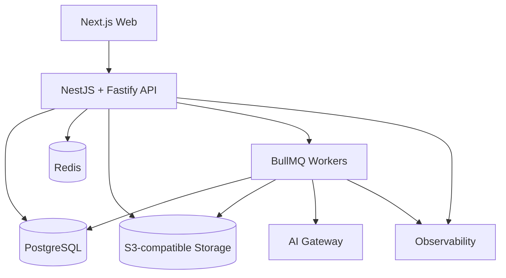

# QUP Architecture

## 1. Architecture Style

**Modular Monolith + Background Workers**

السبب:
- Domain معقد لكنه في بداية المنتج.
- نحتاج boundaries واضحة بدون تكاليف Distributed System.
- يسهل فصل services لاحقًا إذا أثبت القياس الحاجة.

## 2. High-Level Architecture



## 3. Monorepo Structure

```text
qup/
├── apps/
│   ├── web/
│   ├── api/
│   └── worker/
├── packages/
│   ├── contracts/
│   ├── domain/
│   ├── db/
│   ├── adaptive-engine/
│   ├── ai-gateway/
│   ├── ui/
│   ├── observability/
│   ├── config/
│   └── testing/
├── data-science/
│   ├── calibration/
│   ├── evaluation/
│   └── notebooks/
├── docs/
└── infra/
```

## 4. Stack

### Workspace
- TypeScript strict.
- Node.js active LTS pinned عند بدء التنفيذ.
- pnpm workspaces.
- Turborepo.

### Web
- Next.js App Router.
- React.
- Tailwind CSS.
- custom Design System.
- shadcn/ui كقاعدة تنفيذية فقط إن أفاد.
- TanStack Query.
- React Hook Form.
- Zod.

**Web → API (decided at implementation, 2026-10-08):** the browser calls only the web app's own
origin; a server-side route (`apps/web/src/app/api/v1/[...path]`) forwards to the API. One origin
means no CORS and a first-party `HttpOnly` session cookie, and the API address is run-time
configuration. The forwarder is allow-list based and carries no logic — it is transport, not a
second backend. Payment-provider webhooks go to the API directly, never through the web app.

### API
- NestJS.
- Fastify adapter.
- REST V1.
- OpenAPI.
- shared contracts عبر Zod حيث يكون عمليًا.

### Data
- PostgreSQL.
- Drizzle ORM.
- migrations داخل repo.
- pgvector للبحث الدلالي/التشابه.
- Redis للqueues/cache/rate limits عند الحاجة.
- BullMQ للbackground jobs.

### Storage
- S3-compatible object storage.
- private-by-default.
- signed URLs حسب authorization.

### Quality
- Pino.
- Sentry.
- OpenTelemetry.
- Vitest.
- Playwright.
- Docker.
- GitHub Actions.

## 5. Suggested API Module Layout

```text
src/modules/<module>/
├── domain/
│   ├── entities/
│   ├── value-objects/
│   ├── services/
│   └── ports/
├── application/
│   ├── commands/
│   ├── queries/
│   └── dto/
├── infrastructure/
│   ├── persistence/
│   ├── adapters/
│   └── mappers/
└── presentation/
    ├── controllers/
    └── presenters/
```

لا تطبق ceremony إذا لم تضف قيمة، لكن حافظ على dependency direction.

## 6. Modules

- auth
- users
- rbac
- exams
- taxonomy
- questions
- content-import
- assessments
- mastery
- adaptive
- subscriptions
- payments
- ai
- analytics
- audit
- settings
- notifications

## 7. Critical Synchronous Path — Submit Answer

الـcore path لا يعتمد على LLM:

```text
request
→ authenticate
→ authorize ownership
→ validate
→ idempotency check
→ load assessment item/question version
→ grade server-side
→ persist attempt
→ deterministic mastery evidence
→ update mastery with concurrency protection
→ mastery/learning event
→ commit
→ select next action/question
→ safe response
```

AI classification/explanation optional async أو bounded synchronous with fallback.

## 8. Transaction Boundaries

استخدم transaction لـ:
- answer finalization + mastery update + event.
- payment success + entitlement grant.
- publish question/version state transitions.

## 9. Concurrency

حماية ضد request duplication/races عبر:
- unique attempt finalization.
- unique mastery event per attempt/node.
- optimistic row version أو `FOR UPDATE`.
- bounded retry عند conflict.

## 10. Transactional Outbox

```text
DB transaction:
  business write
  +
  outbox_events
commit

worker:
  consume outbox
  → side effects/queues
```

Use cases:
- analytics.
- notifications.
- AI jobs.
- import follow-up.

## 11. Caching

مناسب:
- published taxonomy.
- public stable config.
- safe permission projections.

تجنب stale cache في:
- live mastery.
- mutable assessment state.
- entitlements بدون invalidation واضح.

## 12. Scaling

لا تفصل microservices استباقيًا.
استخراج service فقط عند وجود metric/operational need واضح، مثل heavy import/AI/analytics.

## 13. Deployment Rule

CI يبني/يفحص/يختبر. لا يحق للAgent تنفيذ production deployment أو production migration بدون طلب صريح.
