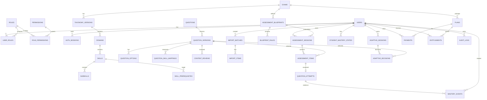

# QUP Logical ERD

هذه ERD منطقية للـMVP. يمكن تعديل أسماء الأعمدة أثناء التنفيذ لكن العلاقات والـinvariants لا تتغير بدون قرار موثق.

## Mermaid ERD

## Identity/RBAC

### users
- id UUID
- email nullable — normalized (trimmed, lower-case), unique when present
- phone nullable — E.164, unique when present
- at least one of email/phone required (OPEN_QUESTIONS.md #6, decided 2026-09-22)
- password_hash (Argon2id), required
- display_name
- status — ACTIVE on creation (no verification step)
- email_verified_at / phone_verified_at — NULL until a verification flow exists
- created_at / updated_at

### auth_sessions
- id
- user_id
- token_hash/opaque id
- expires_at
- revoked_at
- created_at
- last_seen_at

### roles / permissions / user_roles / role_permissions
Initial roles:
- STUDENT
- CONTENT_MANAGER
- ADMIN

Permissions examples:
- questions.create
- questions.review
- questions.publish
- taxonomy.manage
- billing.manage
- users.manage
- audit.view

## Exam/Taxonomy

### exams
- id
- code unique
- name_ar
- name_en nullable
- slug unique
- description
- status
- created_at / updated_at

لا hard-code logic حسب اسم exam.

### taxonomy_versions
- id
- exam_id
- version_code
- status DRAFT/PUBLISHED/ARCHIVED
- effective_from
- created_by
- created_at

Unique `(exam_id, version_code)`.

### domains
- id
- taxonomy_version_id
- code/name/description
- weight
- display_order
- status

### skills
- id
- domain_id
- code/name/description
- weight
- mastery_threshold nullable
- priority_weight default 1
- min_coverage
- display_order
- status

### subskills
- id
- skill_id
- code/name/description
- weight
- mastery_threshold nullable
- display_order
- status

### skill_prerequisites
- skill_id
- prerequisite_skill_id
- importance_weight

No self/cycles.

## Question Bank

### questions
Stable logical identity:
- id
- stable_code unique
- created_by
- created_at
- archived_at

### question_versions
- id
- question_id
- version_number
- status
- question_type
- stem_content JSON/structured rich content
- explanation_content
- difficulty_author_score 0..1
- difficulty_measured_score nullable
- source_type/reference
- taxonomy_version_id
- created_by
- published_at
- created_at

Unique `(question_id, version_number)`.

### question_options
- id
- question_version_id
- key
- content
- is_correct
- display_order

`is_correct` never exposed to student before answer.

### question_skill_mappings
- id
- question_version_id
- skill_id nullable
- subskill_id nullable
- role PRIMARY/SECONDARY
- attribution_weight
- rationale nullable

Exactly one learning target reference per mapping row.

### content_reviews
- id
- question_version_id
- reviewer_id
- decision
- notes
- created_at

## Imports

### import_batches
- id
- uploaded_by
- original_filename
- detected_type
- object_key
- status
- parser_version
- totals JSON
- created_at/completed_at

### import_items
- id
- batch_id
- source_locator
- normalized_payload JSON
- validation_errors JSON
- duplicate_of_question_id nullable
- status
- resulting_question_version_id nullable

## Assessment

### assessment_blueprints
- id
- exam_id
- taxonomy_version_id
- code/type/name
- min_questions / max_questions
- time_limit_seconds nullable
- status
- config_version

Indexes: `(exam_id, code)` unique; at most one `ACTIVE` blueprint per `(exam_id, type)` (partial
unique index, migration 0012). V1 uses only `max_questions` (the diagnosis size; `min_questions`
is 1) and domain-level rules carrying `target_weight` (OPEN_QUESTIONS.md #9a).

### blueprint_rules
- id
- blueprint_id
- domain_id/skill_id/subskill_id nullable
- min_count/max_count
- target_weight
- difficulty_min/max

### assessment_sessions
- id
- student_id
- exam_id (added in migration 0008: a session may have no blueprint row, and "open session for this
  exam" must not need a join through its items; one CREATED/IN_PROGRESS session per student+exam+type)
- blueprint_id
- type snapshot
- status
- started_at/completed_at/expires_at
- scoring_version
- created_at

### assessment_items
- id
- session_id
- question_version_id
- ordinal
- selected_by ADAPTIVE/BLUEPRINT/FIXED
- adaptive_decision_id nullable
- presented_at

### question_attempts
- id
- assessment_item_id unique
- student_id
- submitted_answer JSON
- is_correct
- result_type ANSWERED/SKIPPED/TIMEOUT
- hint_used
- answer_revealed
- response_time_ms
- finalized_at
- idempotency_key
- created_at

## Mastery

### student_mastery_states
- id
- student_id
- exam_id
- skill_id nullable
- subskill_id nullable
- alpha
- beta
- mastery_score
- confidence_score
- evidence_count
- distinct_question_count
- coverage_score
- state
- algorithm_version
- config_version
- row_version
- last_evidence_at
- last_reassessment_at
- updated_at

Unique per student + learning node.

### mastery_events
Immutable:
- id
- student_id
- attempt_id
- skill_id/subskill_id
- before_mastery / after_mastery
- before_confidence / after_confidence
- positive_evidence / negative_evidence
- reason_code
- difficulty
- attribution_weight
- algorithm_version/config_version
- created_at

Critical uniqueness prevents duplicate evidence from same attempt/node.

## Adaptive

### adaptive_sessions
- id
- student_id
- exam_id
- target gap/node
- status
- started_at/ended_at

### adaptive_decisions
- id
- adaptive_session_id
- student_id
- target skill/subskill
- mastery/confidence snapshot
- target_difficulty
- candidate_snapshot JSON
- selected_question_version_id
- reason_codes JSON
- engine/config version
- created_at

## Billing

### plans
- id
- exam_id
- code/name
- price_minor
- currency
- duration_days nullable
- status

### payments
- id
- student_id
- plan_id
- provider/reference
- amount_minor/currency
- status
- idempotency_key
- checkout_url / checkout_expires_at (migration 0009: the provider's hosted page and its expiry)
- redacted provider payload
- created_at/paid_at

One PENDING payment per student + plan (partial unique index, 0009): two open links for one
purchase are how a student pays twice.

### entitlements
- id
- student_id
- plan_id
- exam_id
- source PAYMENT/ADMIN/PROMO
- source_reference
- starts_at/ends_at
- status

## Operations

### audit_logs
actor/action/resource/request_id/redacted metadata/timestamp.

### learning_events
append-only analytics stream with schema_version.

### outbox_events
transactional delivery state.

### system_settings
versioned typed settings; critical rules should not hide in arbitrary JSON.

## Indexing Starting Points

Validate with real queries, likely:
- question versions by status/taxonomy.
- mappings by skill/subskill.
- sessions by student/status.
- mastery by student/exam/state.
- attempts by student/time.
- adaptive decisions by session/time.
- entitlements by student/exam/status.
- import items by batch/status.
