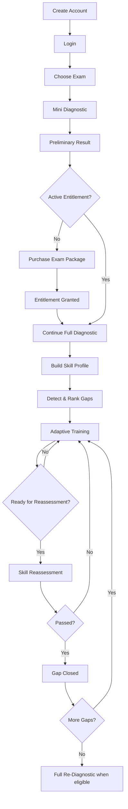

# QUP Workflows

## 1. Student Journey



## 2. Mini Diagnostic

1. الطالب يختار Exam.
2. النظام يحدد free blueprint.
3. ينشئ Session.
4. يختار أسئلة بتغطية وصعوبة مناسبة.
5. كل Answer يسجل ويطبق Evidence المؤهل.
6. ينتج Preliminary Result.
7. Full analysis/training محمي بالEntitlement.
8. بعد الشراء لا ترمى المحاولات السابقة.

## 3. Answer Submission

```text
submit
→ authenticate
→ authorize session ownership
→ validate
→ idempotency
→ grade server-side
→ finalize attempt
→ deterministic mastery update
→ immutable events
→ decide next action
→ safe response
```

## 4. Adaptive Loop

```text
Current Mastery State
→ Highest Priority Gap
→ Target Node
→ Target Difficulty
→ Candidate Filter
→ Candidate Score
→ Choose Question
→ Student Answer
→ Evidence Update
→ Reevaluate
→ Repeat / Reassess / Switch Gap
```

## 5. Reassessment

Eligibility:
- mastery >= threshold.
- confidence >= configured threshold.
- coverage satisfied.

Default baseline:
- 5 fresh questions.
- no hints.
- pass 4/5 + mastery/coverage conditions.

Failure:
```text
READY_FOR_REASSESSMENT
→ DEVELOPING
→ require new evidence
```

## 6. Full Re-Diagnostic

Default configurable gate:
- 7 days cooldown.
- 30 new eligible attempts.

## 7. Manual Question Workflow

```text
Create Draft
→ content/options/correct answer
→ taxonomy mappings
→ difficulty/source
→ validation
→ review
→ approval
→ publish
```

Published edit:
```text
Published v1
→ New v2 Draft
→ Review
→ Publish v2
```

## 8. Bulk Import Workflow

```text
Upload
→ private quarantine
→ detect file type
→ parse/extract
→ normalize
→ validate
→ duplicate detection
→ preview/report
→ resolve taxonomy/missing data
→ create drafts
→ review
→ publish
```

Partial failures are visible and do not silently corrupt valid items.

## 9. Taxonomy Workflow

```text
Select Exam
→ Taxonomy Version
→ Domains
→ Skills
→ SubSkills
→ Weights/Thresholds
→ Prerequisites
→ Validate Cycles
→ Publish Version
```

Historical assessments keep old version references.

## 10. Payment Workflow

```text
Select Package
→ Create Provider Session/Intent
→ Provider
→ Verified Webhook
→ Idempotent Payment Transition
→ Transactional Entitlement Grant
→ Notify Student
```

Browser redirect is not payment source of truth.

## 11. AI-Assisted Content

```text
Source content
→ AI extraction/tag suggestions
→ schema validation
→ Draft
→ human review
→ publish
```
